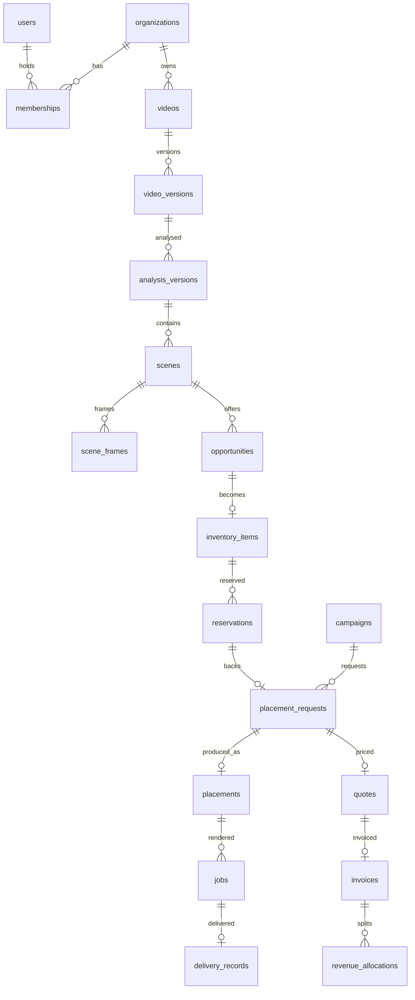

# Domain model

The canonical entities from specification §5, where each lives, who owns it, and how far it is built. **Status** is one of:
- **Live:** stored and used through the API and the web app.
- **Contract:** the table and its validation exist, but nothing writes to it yet.
- **Planned:** not built.

Every tenant-owned row carries `org_id`. Cross-organization records carry both parties' ids. Ids are integers generated by the database.

| Entity | Table | Owner | Status | Notes |
|---|---|---|---|---|
| Organization | `organizations` | itself | Live | `kind`: direct, brand, publisher, agency |
| OrganizationMember | `memberships` | organization | Live | Source of access; one role per organization |
| BrandProfile, PublisherProfile | `brand_profiles`, `publisher_profiles` | organization | Live | |
| Product | `products` | organization | Live | `status` DRAFT, ACTIVE or ARCHIVED. A linked copy in a publisher organization has `source_product_id` |
| ProductAsset | `product_assets` | organization | Live | Versioned images; requests pin a version |
| VideoAsset | `videos` | organization | Live | Soft deletion (`deleted_at`) |
| VideoVersion | `video_versions` | organization | Live | SHA-256, codec, container, audio, aspect ratio |
| AnalysisJob, AnalysisVersion | `analysis_versions` | organization | Live | Staged job state (stage, stages, leases, attempts) on the version row |
| Scene | `scenes` | organization | Live | `HISTOGRAM_CUT` from the pipeline; `LEGACY_KEYFRAME` from the old analysis |
| SceneFrame | `scene_frames` | via scene | Live | Images stored per analysis version |
| DetectedObject, ObjectTrack | `detected_objects`, `object_tracks` | via scene | Implemented (M14) | Written by the DETECTING_OBJECTS and TRACKING_OBJECTS stages; `GET /api/analyses/{id}/objects` |
| PlacementOpportunity | `opportunities` | organization | Live | Typed schema, score breakdown, review |
| AdvertisingInventory | `inventory_items` | publisher | Live | DRAFT, AVAILABLE, RESERVED, SOLD, WITHDRAWN |
| InventoryReservation | `reservations` | brand and publisher | Live | One HELD or CONFIRMED per item |
| Campaign, CampaignProduct, CampaignTargeting | `campaigns`, `campaign_products`, `campaign_targeting` | brand | Live | |
| SceneRecommendation | `scene_recommendations` | brand | Live | Stored per matching run |
| PlacementRequest, Approval | `placement_requests` (brand and publisher approvals), `placement_approvals` (render approval) | both | Live | |
| RenderingJob, RenderedAsset | `jobs` | publisher | Live | |
| DeliveryRecord, DeliveryEvidence | `delivery_records`, `delivery_evidence` | both | Live | |
| Transaction, FinancialLedgerEntry | `quotes`, `invoices`, `ledger_entries` | both | Live | Append-only ledger |
| PublisherRevenueAllocation | `revenue_allocations` | publisher | Live | |
| AnalyticsEvent | `analytics_events` | organization | Live | Filled from outbox events |
| Notification | `notifications` | organization | Live | |
| AuditLog | `events`, `status_transitions` | organization | Live | |

