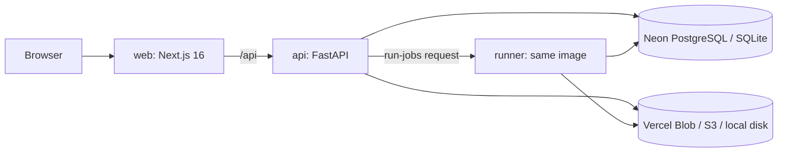

# System architecture

## Shape
A modular monolith (AD-2): one FastAPI application, one database and one job runner, deployed as three Vercel services from one image.

On a machine with a worker process (`worker.py`, or the inline worker in development), the worker polls the queue instead of using the HTTP runner. The code is the same either way.

## Modules
| Module | Owns | Phase |
|---|---|---|
| `app/main.py` | App setup, sessions (`current_user`), uploads, videos, products, placements, quality checks, rendering, legacy keyframes | baseline |
| `app/auth.py` | Sign-in, onboarding | baseline |
| `app/members.py` | Roles, the permission rules, members, invitations, membership sync | baseline, 2 |
| `app/orgs.py` | Organizations, kinds, the active organization, platform administration | 2 |
| `app/videos.py` | Video versions, duplicates, deletion, file metadata | 3 |
| `app/intelligence.py` | The staged analysis job, scenes and frames API | 4 |
| `app/scoring.py`, `app/opportunities.py` | Scoring configurations, brand safety, typed opportunities | 1, 5 |
| `app/inventory.py` | Opportunity review, brand-safety rules, inventory, listing, reservations, notifications | 5, 8 |
| `app/profiles.py` | Brand and publisher profiles, rights records and verification | 6 |
| `app/catalogue.py` | Product states and asset versions, matching | 7 |
| `app/campaigns.py` | Campaigns, targeting, placement requests, two-party approval, production | 9, 10 |
| `app/commercial.py` | Quotes, invoices, ledger, revenue allocation, idempotency | 11 |
| `app/delivery.py` | Delivery records and evidence, analytics consumer, campaign reports | 12 |
| `app/programmatic.py` | Capabilities, inventory feed, adapter contracts | 13 |
| `app/migrations.py` | Ordered, recorded schema migrations | 1 |
| `app/outbox.py` | Transactional outbox and delivery | 1 |
| `app/decisions.py`, `app/quality.py`, `app/tracking.py`, `app/compositor.py`, `app/validation.py`, `app/renderers.py` | The existing decision and insertion engine, unchanged in behaviour | baseline |

Modules call each other's public functions, and cross-module effects that can wait go through the outbox. The only import cycle is the one that existed before (`decisions` ↔ `main`): it is resolved by importing `main` first, as every entry point does.

## Background work
| Kind | Table | Runs in |
|---|---|---|
| Renders | `jobs` | worker loop, HTTP runner |
| Decisions | `decisions` | worker loop, HTTP runner |
| Analyses | `analysis_versions` with `pipeline='visuara-pipeline-v1'` | worker loop, HTTP runner |
| Outbox events | `outbox_events` | worker loop, HTTP runner |
| Hold expiry, hash backfill, session clean-up | — | database maintenance |

All of them use leases and attempt counts, and each claim is a conditional update, so several workers can run safely side by side.

## Integration with the existing engine
The marketplace reuses the existing placement pipeline unchanged (AD-9):
1. A request in production creates an ordinary placement in the publisher's organization, through `create_placement`.
2. That placement goes through the existing quality check, approval and render.
3. The render worker, in the transaction that marks a job SUCCEEDED, calls `delivery.on_render_succeeded`, which records the delivery when the placement belongs to a request.
4. Brand downloads go through `_authorize_delivery`, the same gate the publisher's own downloads use.
