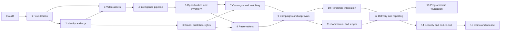

# Project status

> **Superseded.** This is the record as of before V4.0 M14. The current state is in [docs/engineering/FINAL_RELEASE_REPORT.md](../engineering/FINAL_RELEASE_REPORT.md) and, for the intelligence pipeline, [docs/engineering/AI_EVALUATION.md](../engineering/AI_EVALUATION.md).

**5 November 2026:** Phases 0 to 15 are implemented, and the final audit is done. The marketplace works end to end locally, in the browser, from analysis to accepted delivery. **The MVP is not production-ready.**
- The live site does not start (B-1 to B-3).
- Object detection is unavailable (B-6).

See [MVP_RELEASE_REPORT.md](../release/MVP_RELEASE_REPORT.md).

## Where things stand
- **Works and is verified locally:**
  - Separate brand, publisher and administrator organizations.
  - Staged video analysis with versioned scenes and opportunities.
  - Rights-aware inventory, reservations with conflict handling, campaigns, and two-party placement approval.
  - Production through the existing placement engine.
  - Quotes, invoices and a balanced append-only ledger.
  - Delivery with evidence, and campaign reports.
  - Programmatic capabilities, labelled with what is designed only.
  - Deployment hardening: a nonce-based Content-Security-Policy on every page, and secret scanning of the files and the whole git history that never prints a value. Go-live refuses credentials already in history, and sign-up asks what the new workspace does (H-01 to H-06).
  - The ledger: [IMPLEMENTATION_LEDGER.md](IMPLEMENTATION_LEDGER.md).
- **Not available:**
  - Object detection and tracking (B-6).
  - Payment capture, since payment is recorded by an administrator (B-4).
  - Real-footage accuracy (B-7).
  - Programmatic buying.
- **Live site:** down until the owner clears [B-1 to B-3](BLOCKERS.md).

## Roadmap
| Phase | Delivers | Status |
|---|---|---|
| 0 | Audit, baseline, decisions, roadmap | Done |
| 1 | Ordered migrations; canonical tables; contracts | Done |
| 2 | Memberships and active organization; kinds; platform admin; permissions | Done |
| 3 | Content hashing, duplicates, versions, deletion, metadata | Done (versions and deletion are API only) |
| 4 | Staged analysis job; immutable versions; segmentation | Done; detection and tracking blocked (B-6) |
| 5 | Typed opportunities, versioned scoring, inventory, brand safety | Done |
| 6 | Brand and publisher profiles; rights records and verification | Done |
| 7 | Catalogue states and assets; brand-to-scene matching | Done |
| 8 | Listing, pricing, reservations with conflicts and expiry | Done |
| 9 | Campaign lifecycle; placement requests; two-party approval | Done |
| 10 | Production through the existing render engine | Done |
| 11 | Quotes, invoices, ledger, revenue allocation, idempotency | Done; payment capture blocked (B-4) |
| 12 | Delivery records and evidence; reporting from events | Done |
| 13 | Programmatic interfaces and adapter contracts | Done (designed-only parts labelled) |
| 14 | Security, isolation, adversarial and end-to-end tests | Done |
| 15 | Demo environment, release report | Done |

The dependency graph from Phase 0 still holds:

## Release gates
| Gate | Status | Why |
|---|---|---|
| A: Intelligence | **Passed locally, with limits** | Real upload, asynchronous staged analysis, persisted scenes, opportunities, searchable inventory and failure recovery are all tested on real (synthetic) video. Detection is `UNAVAILABLE` (B-6), and accuracy is measured on synthetic footage only (B-7) |
| B: Marketplace | **Passed locally** | Separate accounts, products, rights-aware inventory, recommendations, campaigns, requests, publisher approval, rendering and brand acceptance, walked in the browser (12/12, including sign-up as a publisher and deletion) |
| C: Commercial | **Passed locally, except payment capture** | Reservations (real-thread race test), lifecycle, transaction states, revenue allocation, a balanced ledger, delivery status and reporting. Payment is recorded by an administrator, not captured (B-4) |
| D: Release readiness | **Not passed** | Not met: blockers B-1 to B-3 are still open. Also open: B-6 is high severity, and the deployment rehearsal (B-9) has not run. Met: security tests, critical integration and end-to-end tests on the final code (182 tests on each database; the one failure, an outdated secret-scanner expectation, was fixed and re-run; both browser walks 12/12), no regressions, a reproducible demo environment and a documented deployment procedure |
