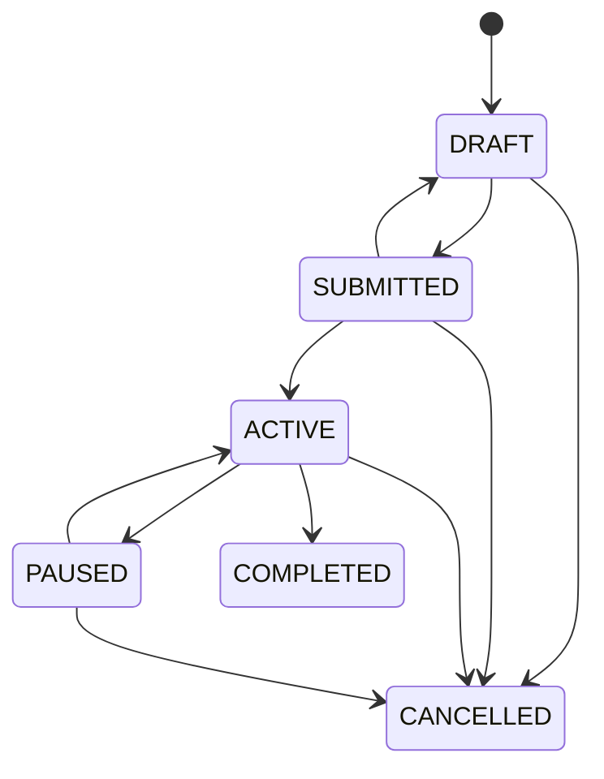

# Campaign lifecycle

Every status change in this document is written to `status_transitions` with who made it and why.

## Campaign

- **Submitting or activating:** needs at least one product.
- **Automatic activation:** the first request a publisher approves activates a submitted campaign.
- **Cancelling:** cancels its open requests and releases its held reservations.
- **Budget:** requests may not exceed it. A budget can't be lowered below what is already committed.

## Reservation
- **HELD:** for 15 minutes, extended while a request is open.
- **CONFIRMED:** when the publisher approves the request.
- **RELEASED:** by the brand, or when a request is cancelled or rejected.
- **EXPIRED:** when the hold runs out. This is checked on every browse, reserve and list, and by database maintenance.

## Placement request
| Status | Reached when | Effect |
|---|---|---|
| REQUESTED | A brand manager requests (the brand's approval) | Publisher notified; hold extended |
| APPROVED | The publisher's manager approves | Reservation CONFIRMED; item SOLD; quote ISSUED |
| REJECTED or CANCELLED | The publisher rejects, the brand cancels, the reservation expires or the campaign is cancelled | Reservation released; item AVAILABLE |
| IN_PRODUCTION | The publisher starts production | Linked product and placement created in the publisher's organization |
| DELIVERED | A render of that placement passes validation | Delivery record with OUTPUT, VALIDATION, APPROVALS, RIGHTS and PROVENANCE evidence |
| ACCEPTED | The brand accepts the delivery | Delivery ACCEPTED |

## Quote and invoice
- **Quote:** ISSUED on approval, then ACCEPTED by the brand, which issues an invoice.
- **Invoice:** ISSUED, then PAID when a platform administrator records the bank payment.
- **Publisher's share:** PENDING, then PAYABLE on payment, then PAID on payout.
